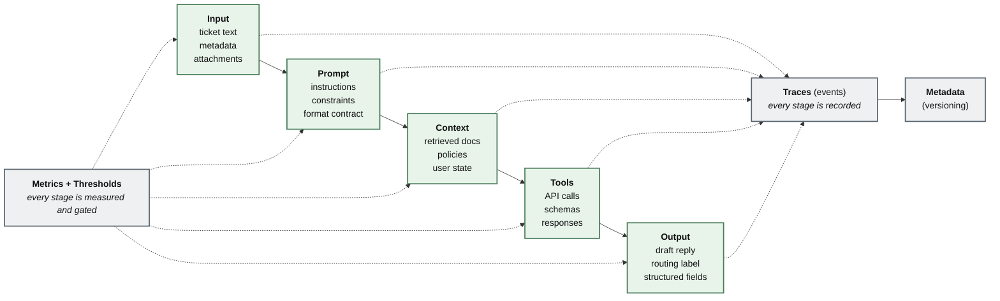
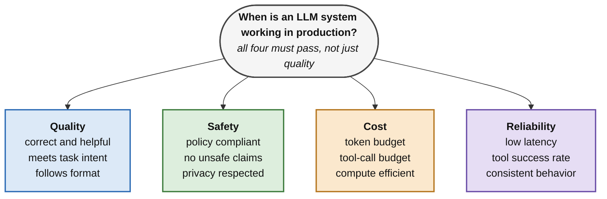
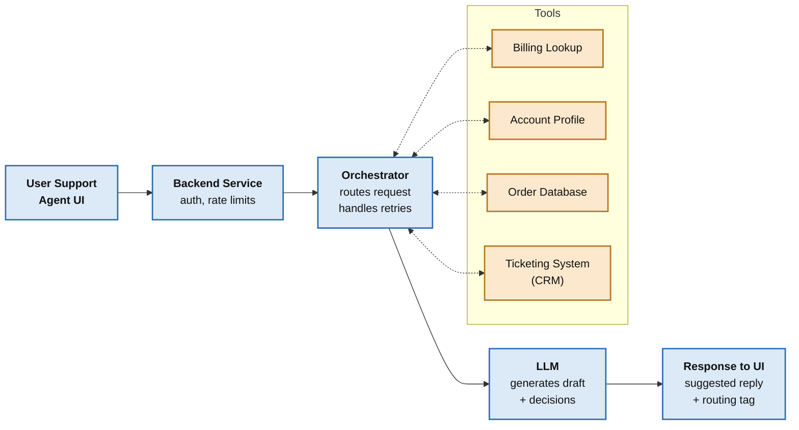

# Chapter 1: Foundations of LLM Evaluation: Core Concepts and Primitives

**Main idea:** An AI chatbot product must be tested as a whole system, not just the AI model, and the test results must lead to clear decisions like "ship it" or "stop it."

**Key points:**
- The book starts with a story about a support team that launched an AI assistant after a good demo.
  - Example: In the demo, the assistant sent tickets to the right team, wrote polite replies, and seemed to know when to use the billing tool.
  - Example: A week later, it told a customer their refund was confirmed, but the refund never actually happened. It had skipped the required billing check, yet still sounded confident.
- The real problem was not just that the AI made a mistake. The team had no testing process to catch it.
  - They could not check if the AI was actually using its tools.
  - They could not check if its final answer was based on real, verified facts.
  - They had no rule saying risky refund cases should stop the launch.
- The book's goal is to prevent this kind of failure.
- An AI product is more than the AI model. It is a full system made of:
  - The base model, prompts (instructions given to the AI), retrieved information, tools, rules, and fixed output formats.
  - Settings that control how the AI answers, like temperature, top-p, max tokens, and retry settings.
- Since all these parts together decide how the product behaves, testing must cover the whole system.
- There are three different kinds of checking:
  - **Model evaluation:** Is the base AI model generally capable enough for the task?
  - **System evaluation:** Does this specific setup (model, prompt, tools, rules, format) work well?
  - **Operational monitoring:** After launch, does the system keep working safely with real users?
  - These overlap but happen at different times, are owned by different people, and need different tools.
- This chapter mainly focuses on system evaluation, and also shows how it links to monitoring after launch.
- A single score is not enough. Results must be tied to limits, and limits must be tied to actions.
  - Example: Saying "helpfulness is 8.2 out of 10" or "routing accuracy is 92%" alone is not useful.
  - The actions should be clear: ship, block, investigate, roll back, or fix the issue.
- The chapter uses one main example throughout: an AI support assistant that reads tickets, routes them, writes replies in the right tone and format, and uses tools to check facts and rules.
- This example was chosen because it includes all the hard parts of AI testing: open-ended writing, sorting tasks, fetching information, tool use, rule-following, speed, and cost.
- The same approach works for other AI products too.
  - Example: coding assistants, RAG systems (AI that looks up documents before answering), internal company helpers, and agent workflows.
  - Later chapters cover more advanced cases like multimodal (text plus images, audio, etc.) and agent systems.
- After this chapter, the reader should be able to:
  - Test AI using basic building blocks and step-by-step pipelines instead of vague benchmark scores.
  - Build a testing setup that gives reliable results even though AI answers can change each time.
  - Pick the right type of checker for each kind of mistake.
  - Create test sets split into groups (slices) so a good overall score doesn't hide weak areas.
  - Turn test results into limits, launch checkpoints, and rollback rules.
  - Know the minimum tracking needed in production, considering changing tools, user traffic, and rules.
- The basic method used in the whole book: define the system, collect evidence, compare it with limits, then take an action.
- Topics covered in this chapter:
  - What AI product evaluation is, and what it is not
  - Why old machine learning testing methods fail for AI that writes text or acts on its own
  - What "working" means in production: quality, safety, cost, and reliability
  - Basic shared terms for evaluation
  - Building test sets and datasets
  - Types of evaluators (checkers)
  - Getting repeatable, sensible results when AI answers vary
  - Moving from basics to pipelines: offline testing, online testing, and regression gates (checks that stop a release if things get worse)
  - Benchmarks vs. real-world testing: what carries over, what misleads, and why
  - How detailed the evaluation should be
  - Tool setups: test harness design, version tracking, dashboards, and storing traces (records of what the AI did)

**In short:** Test the whole AI system with real evidence, set clear limits, and use the results to decide whether to launch, stop, or fix it, so failures like the fake refund don't happen.

## 1. What evaluation means for LLM products
**Main idea:** Before going deeper, we need a clear meaning of "evaluation" for AI products.

**Key points:**
- This definition comes first, before talking about datasets, evaluators (checkers), dashboards, or deployment gates (checkpoints before launch).
- In AI products, evaluation is not just giving scores to the AI's answers.
- Evaluation means collecting proof of how the whole system behaves, then using that proof to make product decisions.
- This section covers three things:
  - The idea that evaluation should lead to decisions.
  - Why quality is only one part of being ready for real users (other parts matter too).
  - The difference between metrics (the numbers) and the actions those numbers are meant to guide.

**In short:** Evaluation is about gathering evidence to make decisions, not just scoring answers.

### 1.1. Evaluation is a decision system, not a score
**Main idea:** In real-world AI products, evaluation is not just a score. It is a decision system with four parts: evidence, uncertainty, a threshold, and an action.

**Key points:**
- The four parts of evaluation:
  - **Evidence:** what you measure.
    - Example: an automatic metric, a score from an AI judge (another AI grading the answers), a fixed rule-based check, a check based on traces (records of what the AI did), or a human rating.
  - **Uncertainty:** how much you can trust that evidence.
    - This matters most when AI answers change from run to run, when you have few test samples, or when AI judge scores differ each time you run them.
  - **Threshold:** a limit you decide on before making a decision.
  - **Action:** what you do when the evidence goes past that limit.
- Evaluation is only useful if it can change what the team does.
  - Example actions: decide to ship or not ship, block a release, start an investigation, roll back a canary (a small trial release to some users), or require a fix.
  - If a result can't lead to any of these, it is not evaluation. It is just reporting.
- In the support assistant example, the assistant reads tickets, picks a category, writes a reply, and sometimes uses tools to check billing or get account details.
- Here, evaluation means answering practical questions about launching and running the product:
  - Can we safely ship this new version?
  - Has reply quality gotten worse compared to last week?
  - Are tool calls failing more often today?
  - Has cost gone over budget?
  - Are failures mostly happening in one group, such as a type of user, a language or region, a risk level, or a type of request?
- These are decision questions, and one single number cannot answer them.
- Thresholds are not random numbers added at the end. They are part of the product's rules.
- Teams can set starting thresholds using:
  - Past results (historical baselines)
  - How much risk stakeholders are okay with
  - Business service goals (service-level objectives)
  - Legal or policy rules
  - Manually reviewing typical examples
- Different problems can have different strictness levels.
  - Example: A support assistant might allow a few formatting mistakes, but be much stricter about refund claims that aren't backed by real facts.
- Thresholds should be checked and adjusted as more real-world data comes in.
- You don't need perfect numbers on day one. What matters is that the limit is clear, can be reviewed, and can be changed as evidence improves.

**In short:** Evaluation means measuring evidence, knowing how much to trust it, comparing it to a set limit, and taking a clear action, with limits that get adjusted over time.

### 1.2. Quality is only one axis
**Main idea:** In real use, a "working" AI assistant must be good in four areas: quality, safety, cost, and reliability, not just quality.

**Key points:**
- Many teams only check quality and stop there.
- But in production, the assistant must also be safe, reliable, and stay within time (latency) and money (cost) limits.
- An assistant can give great answers and still fail.
  - Example: it can be too slow to use, too costly to run, or unsafe in rare but very serious cases.
  - In production, these count as failures, no matter how good the average answer sounds.
- The four areas of "working":
  - **Quality:** Is the system helpful and correct for its job?
  - **Safety:** Does it follow rules, protect privacy, and stay within risk limits?
  - **Cost:** Does it stay within a budget the team can keep paying?
  - **Reliability:** Does it behave consistently, and are speed, uptime, and tool availability good enough?
- Latency (how long it takes to respond) is usually part of reliability, but some teams track it separately.
- The key point: production testing must look at many areas, not just one.
- For the support assistant example:
  - **Quality:** sending tickets to the right place and writing useful replies.
  - **Safety:** not leaking personal data, not making up account actions, and not breaking policy.
  - **Cost:** tokens used (pieces of text the AI processes), document lookups used, and unneeded tool calls.
  - **Reliability:** p95 latency (the response time that 95% of requests stay under), how often tools succeed, what happens when something fails (fallback), and steady results across repeated runs.
- A new version is not ready just because one area got better.
- It is ready only when all the important areas meet the product's set limits.

**In short:** A good AI product must pass on quality, safety, cost, and reliability together before it can be released.

### 1.3. Metrics are not decisions
**Main idea:** Metrics are just measurements, but decisions are rules, and thresholds are what connect the two.

**Key points:**
- A metric tells you a number. A decision tells you what to do with that number.
  - Example: The metric says "routing accuracy is 92%." The decision says "we ship if routing accuracy is at least 90% overall and at least 88% for each important type of request."
  - Example: The metric says "policy violation rate is 0.2%." The decision says "we don't ship if high-risk policy violations go above 0.1%, or if even one zero-tolerance violation shows up in the release tests."
- Without thresholds (set limits), metrics can't lead to action, and every release turns into an argument.
- So metrics, thresholds, and actions should be planned together.
- A helpfulness score is only useful if the team knows:
  - What score is good enough
  - How much the score normally changes across repeated runs
  - Which groups of cases (slices) matter most
  - What to do when the score goes down
- This book treats thresholds as very important, because they are the bridge between measuring and acting.
- Next, the book will make the definition clearer by showing what evaluation is often confused with:
  - One-time benchmark tests
  - Informal demos
  - Tweaking the prompt until one single example works

**In short:** Numbers alone don't decide anything; clear limits turn measurements into actions and stop release debates.

## 2. What evaluation is not
**Main idea:** Some activities look like evaluation but are not, because they don't give organized, repeatable proof that can guide decisions.

**Key points:**
- People often mix up evaluation with things that seem useful but only give stories and opinions instead of real engineering evidence. This can be costly.
- **Evaluation is not running a benchmark once per model.**
  - Benchmarks can help pick a model early on, but they are not enough to test a product.
  - A benchmark tests a model under fixed conditions.
  - A real assistant runs with your own prompt, document lookup setup, tools, rules, output format, settings, and real user traffic.
  - A model can score well on a general benchmark but still fail in your product, because the benchmark never tested your tool calls, rules, speed limits, user groups, or rare high-risk cases.
- **Evaluation is not asking a few teammates if it looks good.**
  - That is just a demo review, not evaluation.
  - A few manual checks are biased, cover very little, and can't be repeated reliably.
  - Manual review only counts as evaluation when reviewers use set test cases, rubrics (scoring guides), slice labels (group tags), and pass/fail rules, so results can be compared between versions.
- **Evaluation is not tweaking the prompt until one demo works.**
  - This trap is common because prompt changes are quick.
  - Example: A team finds a failure, fixes the prompt, reruns that same example, and sees it now works.
  - But that fix might only work for that one case, make another type of request worse, raise cost, or make a high-risk group less safe.
  - Prompt changes should be tested like code changes: with typical test sets, tricky (adversarial) cases, important groups, and the right checkpoints.
- **Evaluation is not a one-time step.** It is a loop with three stages:
  - **Before launch (offline):** run test sets, compare new versions to the old one, and check safety, quality, reliability, and cost limits.
  - **During launch (canary):** watch live signals like tool failures, refusal rate, fallback rate, p95 latency, and policy violations.
  - **After launch (online):** record what matters, measure drift (slow changes over time), pick cases for review, and add new tests after problems or near misses.
  - The cycle is: ship, observe, learn, add tests, improve, and ship again.
- Next, the chapter will clearly define the support assistant example, so every concept, metric, test set, checker, and checkpoint has the same product context.

**In short:** Real evaluation is an ongoing, repeatable loop of testing and monitoring, not a one-time benchmark, a quick team opinion, or a prompt fix for one demo.

## 3. Running example setup: The production assistant
**Main idea:** The chapter uses one example, an AI customer support assistant, to show real-world evaluation problems in a simple way.

**Key points:**
- Since evaluation is a loop, the chapter uses one running example to make it concrete: an AI assistant for a customer support team.
- The example is simple to follow but detailed enough to show real problems in AI products.
- The assistant does three main jobs:
  - **Routing:** sends each ticket to the right category.
    - Example: billing, bug report, account access, cancellation, or escalation.
  - **Drafting replies:** writes a reply with the right tone, format, and level of detail.
  - **Using tools:** when the answer needs checked facts, it calls tools.
    - Example: billing lookup, account-status check, policy search, or ticket-history lookup.
- This example is useful because it mixes many types of testing in one product:
  - Routing works like a classification (sorting) task.
  - Writing replies is open-ended text generation.
  - Billing and account questions need tool use and trace checks (checking the record of what the AI did).
  - Account access and payment disputes bring in rules and safety limits.
  - Speed and cost matter because the assistant is part of a support team's daily work.
  - So the example lets us test a full product, not just a standalone model.
- The assistant counts as "working" when it meets measurable goals. It should:
  - Route most tickets correctly
  - Give helpful, accurate replies
  - Follow tone and format rules
  - Respect policy rules
  - Call the right tools when facts need checking
  - Handle tool failures safely
  - Stay within speed limits
  - Keep cost per ticket within budget
- Not all failures are equally serious.
  - Example: A small formatting mistake is very different from confirming a refund without checking, or skipping identity checks when someone tries to access an account.
- The assistant is used to show the book's core structure:
  - **Primitives:** what the system receives, uses, produces, and records.
  - **Pipelines:** how evaluation runs before launch, during rollout, and after launch.
  - **Gates:** how results turn into actions like ship, block, investigate, fix, or roll back.
- Later chapters reuse this structure for advanced topics.
  - Example: multimodal systems, deeper human review, comparing two answers side by side (pairwise and preference methods), and complex agent systems.
- **Figure 1.1 (the assistant's architecture)** shows five steps in a row:
  - **Input:** ticket text, metadata (extra details), and attachments.
  - **Prompt:** instructions, constraints, and format contract (required output shape).
  - **Context:** retrieved documents, policies, and user state.
  - **Tools:** API calls, schemas (data formats), and responses.
  - **Output:** draft reply, routing label, and structured fields.
  - On top, **Metrics + Thresholds** connect to every step, meaning each step can be measured and checked against limits.
  - Below, **Traces (events)** record what happens at every step.
  - Traces link to **Metadata (versioning)**, which keeps track of which version of everything was used.
- Next, the chapter will use this assistant to explain why old machine learning testing habits fail when AI answers are open-ended, random, dependent on the prompt, and sometimes go through tools.

**Figure 1.1 – The support assistant as a set of evaluation primitives**

*Solid arrows are the request flow. Dotted arrows show that every stage is both measured against thresholds and recorded into traces, and traces carry the version metadata.*
**In short:** The support assistant example shows that a working AI product must be tested at every step, from input to output, with clear limits, records, and version tracking.

## 4. Why traditional ML evaluation breaks for generative and agentic systems
**Main idea:** Old-style machine learning testing doesn't fit AI chatbot products well, because these products behave in more complex ways.

**Key points:**
- Classic machine learning testing assumes a fixed link between input and output.
  - You have an input, a correct answer (label or reference), and you compare the model's guess to that correct answer (ground truth).
- This works well for many supervised tasks (where the right answer is already known), but it is too limited for real AI products.
- AI products are different because they:
  - Give open-ended answers
  - Give different answers each time you run them
  - Depend heavily on the prompt and the information given to them
  - May take in-between steps using tools or workflows
- This section explains four traits that make old testing methods not enough:
  - **Open-ended outputs:** there's no single right answer.
  - **Stochastic behavior:** answers change randomly from run to run.
  - **Prompt-context coupling:** the result depends closely on the prompt and context.
  - **Agentic or tool-using execution:** the AI takes actions and uses tools along the way.
- These traits don't make testing impossible.
- They mean we must shift from testing the model alone to testing how the whole, fully set-up system behaves.

**In short:** Because AI answers are open-ended, random, prompt-dependent, and tool-driven, we must test the full system, not just the model.

### 4.1 Open-ended outputs break "single ground truth"
**Main idea:** AI answers can be correct in many different ways, so testing should check what the answer does, not whether it matches one exact text.

**Key points:**
- In many AI tasks, there is more than one good answer.
  - The assistant can write different replies that are all fine.
  - It can use different words and still be correct.
  - It can ask a follow-up question when a ticket is unclear.
- If you test using exact match (checking if the answer is word-for-word the same as a reference), you may:
  - Punish answers that are actually correct
  - Reward answers that just look similar on the surface
- Example ticket: "I was charged twice this month. Can you refund the extra charge?"
  - A good reply might ask for missing details (like an ID), explain the refund process and how long it takes, apologize without promising too much, and follow the required support template.
  - Another good reply might use completely different words but still do all the same things.
  - Two good replies may share very few words.
  - Exact match might mark one of them wrong. That is a problem with the test, not with the AI.
- So testing should check behavior, not exact wording.
- Instead of "does it match the reference text?", the checker should ask if the reply follows the task contract (the rules it must meet):
  - Did it avoid saying a refund was given without checking first?
  - Did it ask for missing information when needed?
  - Did it use the right tone and format?
  - Did it follow policy?
- That's why AI testing often uses these instead of exact match alone:
  - Behavioral checks (checking what the answer does)
  - Rubrics (scoring guides)
  - Deterministic validators (fixed rule-based checks)
  - Trace-based checkers (checking the record of the AI's steps)

**In short:** Since good AI answers can be worded many ways, testing should check whether the answer follows the rules, not whether it matches one exact sentence.

### 4.2. Stochasticity breaks "one run = one answer"
**Main idea:** AI systems give different results each time they run, so one test run is not enough to trust the result.

**Key points:**
- AI systems are often stochastic, meaning their answers have some randomness.
- Things that can change the output:
  - Settings like temperature, top-p, max tokens, and retry settings
  - Tool responses, which can change over time
  - System load, which can affect speed and cause timeouts, changing what the user sees
- Because of this, a single test run is not a steady measurement.
- Example: A team tests 50 open-ended support replies with temperature set to 0.7 and runs the same test set five times.
  - The average helpfulness score may look fine in one run but borderline in another.
  - A required billing tool call may happen in most runs but get skipped a few times.
  - If those skipped tool calls happen in refund or account-access cases, it's not just small random noise. It's a real risk in production.
- So instead of testing one output, we test the range (distribution) of possible outputs for a fixed setup.
- In this chapter, repeatability doesn't mean getting the exact same text every time.
  - It means the variation stays within limits and the decisions stay the same.
- A team should be able to tell whether a change in results is big enough to matter, or just normal run-to-run variation.

**In short:** Since AI answers vary from run to run, test many runs and judge whether changes are real problems or just normal variation.

### 4.3. Prompt and context coupling breaks the model-centric worldview
**Main idea:** In AI products, behavior depends on the whole setup (prompt, documents, tools, rules, settings), not just the model, so every part must be tracked and tested.

**Key points:**
- Old-style testing focuses on the model: train it, test it, launch it.
- AI products are different because prompts, retrieved information, tools, policies, and settings are all part of the system setup.
  - Changing the system prompt can change behavior more than switching to a new model version.
  - Changing how documents are fetched (retrieval) can change factual accuracy even if the model stays the same, because the model is now answering from different documents or policy pieces.
- This creates a "too many combinations" problem.
  - Behavior depends on prompt × retrieval setup × tool format × policy version × settings.
  - Each new part adds more possible system states, so testing every combination becomes impossible.
- That's why simple averages are not enough. Production testing needs:
  - **Risk-based priority:** test the most dangerous cases first.
  - **Slice-based coverage:** test different groups of cases separately.
  - **Versioned setups:** track exactly which version of each part was used.
- Examples from the support assistant:
  - A prompt asking for shorter answers might lower cost but make replies less helpful.
  - Fetching more documents might cover more info but also bring in unrelated or conflicting content.
  - Updating a billing policy document might change what the assistant should say, even if the model and prompt don't change.
  - If the team only tracks the model version, it will blame the wrong cause when things get worse.
- So production testing should track versions of:
  - Prompts
  - Retrieval setups
  - Document collections or index snapshots (saved copies of the search index)
  - Tool schemas (data formats)
  - Policies
  - Evaluator (checker) versions
  - Settings (inference parameters)
- It should also record enough details to rebuild exactly what the model saw.
- Without this tracking, comparing results is just guessing.

**In short:** Since many parts shape AI behavior, track versions of all of them and focus testing on risky cases, or you won't know what caused a problem.

### 4.4. Agents break static input-output assumptions
**Main idea:** AI systems that use tools go through many hidden steps before the final answer, so testing must check those steps too, not just the final reply.

**Key points:**
- Old-style testing assumes one step: input goes in, output comes out.
- Tool-using and agentic (action-taking) AI systems do much more. They may:
  - Plan, fetch information, call tools, pass inputs (arguments) to tools, retry after failures, apply rules, ask follow-up questions, and then write the final reply.
  - The final reply is only the last visible step of a longer process.
- Example: even a simple support assistant follows steps:
  - Sorts the ticket
  - Decides if it needs outside information
  - Gets account or billing details
  - Applies policy rules
  - Writes the final reply
- The final reply can look fine even if a step in between went wrong. The assistant might:
  - Call the wrong tool
  - Pass wrong inputs to a tool
  - Skip a required check
  - Handle a timeout badly
  - Confirm an action it never actually checked
- If testing only scores the final text, these step failures stay hidden.
- For tool-using systems, testing must also check the in-between steps:
  - Which tool was picked
  - Whether tool inputs were valid
  - How often tools succeeded
  - How retries were handled
  - What happened when something failed (fallback)
  - Policy checks
  - Trace events (records of each step)
- These steps count as part of the output, because they decide whether the final answer is based on real facts, safe, and workable.
- This chapter mainly focuses on support-style assistants and simple agent workflows with limited tool use inside one task.
  - Longer, more complex planning agents have extra problems, such as small errors adding up over many steps, bad overall plans, and drifting away from the real goal over long tasks.
  - These need the same primitive-pipeline-gate approach, plus special agent testing methods.
- Key takeaway: a real AI system is not just the model. It is the full setup: model, prompt, context, tools, policies, output rules, settings, and the environment it runs in.
  - If any part changes, behavior can change.
- So testing should tell you:
  - What changed
  - How behavior changed
  - Whether the change is meaningful
  - Whether it crosses a limit that needs action
- Version tracking and logging make this possible, but they don't prove the cause by themselves.
  - Example: If a retrieval setup changed at the same time accuracy dropped, that's only a guess about the cause, not proof.
  - The team still needs targeted reruns, ablations (removing or changing one part at a time to see its effect), or controlled comparisons to find the real cause.
- That's why we need shared terms to describe what the system uses, produces, and records. These are introduced next as evaluation primitives.

**In short:** Check every step an AI takes, not just its final answer, and confirm the real cause of problems with careful tests instead of guessing.

## 5. Defining "working" in production: quality, safety, cost, reliability
**Main idea:** "Working" in production means more than good quality; it needs several areas, each tied to things you can measure.

**Key points:**
- Since evaluation is about gathering evidence for decisions, the next question is: what does "working" really mean in production?
- Many teams just say "quality," but that's not enough.
- A system can give smooth, helpful replies and still be:
  - Unsafe
  - Too expensive
  - Too slow
  - Unreliable when tools fail
- So a real definition of "working" must cover several areas, and each area must be linked to signals you can measure.
- This section will cover:
  - The four production areas: quality, safety, cost, and reliability
  - How to turn product goals into metrics
  - How to decide which metrics matter most
  - How to set gates (launch checkpoints) and rollback rules for the support assistant

**In short:** A working AI product must be measured on quality, safety, cost, and reliability, with clear checkpoints and rollback rules.

### 5.1. The four-axis definition of working (Q/S/C/R)
**Main idea:** A working AI product must do well on quality, safety, cost, and reliability, and the tradeoffs between them must be clearly measured and decided on purpose.

**Key points:**
- The four production areas:
  - **Quality:** Is the system helpful, correct, complete, and right for the task?
  - **Safety:** Does it follow policy and protect privacy and security, staying within risk limits?
  - **Cost:** Does it stay within a budget the team can sustain, including tokens, document lookups, tool calls, and infrastructure?
  - **Reliability:** Does it behave consistently, with acceptable speed, uptime, tool availability, and fallback handling?
- For the support assistant:
  - **Quality:** routes tickets correctly and writes replies that are useful, accurate, complete, and well formatted.
  - **Safety:** doesn't leak personal data, doesn't make up account actions, doesn't skip identity checks, and follows policy for sensitive requests.
  - **Cost:** doesn't waste tokens, doesn't fetch more documents than needed, and doesn't call tools when not needed.
  - **Reliability:** replies are fast enough for support work, tool calls succeed often enough, and failures are handled safely instead of giving misleading answers.
- This approach avoids a common mistake: thinking a better-sounding answer means a better system.
  - Example: A version with a nicer tone but more unbacked refund claims is not better.
  - Example: A version with more complete answers but double the cost per ticket may not be launchable.
  - Example: A version that does well in testing but fails whenever the billing tool times out is not ready for real use.
- Tradeoffs must be clear. Improving one area often affects another.
  - Example: Longer prompts and more document lookups can improve quality but raise cost and slow things down.
  - Example: Stricter safety rules can reduce risky answers but cause more refusals on harmless requests.
  - Example: Limiting tool calls can cut speed and cost but hurt accuracy on tickets that need checked account info.
- Tradeoffs are not bad by themselves. They become a problem when nobody states them openly.
  - If the team doesn't decide how much extra cost is okay for better quality, or how many extra refusals are okay for more safety, release decisions turn into opinion-based arguments.
  - Testing should make tradeoffs clear so product, engineering, safety, and operations teams can decide on purpose.
- Example decisions:
  - The team might accept a 5% rise in average tokens per ticket if high-risk policy violations drop meaningfully.
  - The same team might reject a 20% cost rise if helpfulness improves only slightly on low-risk tickets.
  - The right choice depends on the product, but the tradeoff must be measurable.

**In short:** Judge an AI product on all four areas, and make tradeoffs between them clear and measurable so teams decide on purpose, not by argument.

### 5.2. Turning product goals into measurable signals
**Main idea:** "Working" must be turned into measurable signals, and only a few key metrics should directly drive decisions while the rest help explain problems.

**Key points:**
- "Working" needs signals you can measure.
- The goal is not to measure everything, but to measure what drives decisions.
- Example: product rules for the assistant turn into signals:
  - "Route tickets correctly" → routing accuracy
  - "Don't say a refund is issued unless verified" → unsupported action-claim rate
  - "Reply in under 3 seconds at p95" → p95 end-to-end latency (95% of replies come within this time)
  - "Stay under the cost budget per ticket" → average tokens per ticket and tool calls per ticket
- A good evaluation program splits metrics into two types:
  - **Load-bearing metrics:** the few metrics that directly decide ship, block, roll back, or fix.
    - Example: high-risk policy violation rate, routing accuracy on critical request types, p95 latency, and cost per ticket.
  - **Diagnostic metrics:** metrics that help explain why a load-bearing metric changed.
    - Example: retrieval hit rate (how often the right document is found), average number of documents fetched, how often fallback is used, how much AI judge scores vary, and tool speed for each endpoint.
- This split matters because teams often track too many metrics and then treat none as important.
  - If everything is on a dashboard but nothing is tied to an action, evaluation becomes noise.
  - Simple rule: pick two or three load-bearing metrics for each production area, and use the rest for debugging.
- Different signals come from different places:
  - Some are like classic machine learning testing.
    - Example: routing accuracy.
  - Some depend on how the system behaves.
    - Example: checking if a refund claim was backed by a successful billing tool call.
  - Some need logging and tracking.
    - Example: p95 latency, timeout rate, and tokens per ticket.
  - This is another reason system testing must record more than just input and output.
- Actionable metrics are ones that change decisions.
  - If a metric changes and nobody knows what to do, either it's not important or it's missing a threshold (limit).
- Example actions:
  - Block launch if routing accuracy on critical request types falls below the target.
  - Roll back a canary (small trial release) if the tool failure rate goes past the allowed limit.
  - Investigate before shipping if tokens per ticket jump sharply without better quality.

**In short:** Measure only what drives decisions, keep a few key metrics tied to clear actions, and use the rest to figure out why things changed.

### 5.3. Risk tiers and severity mapping
**Main idea:** Not all failures are equally serious, so failures should be grouped by risk level, and the most dangerous ones should block a launch even if they are rare.

**Key points:**
- Some failures are just annoying, while others are so serious they should stop a launch even if they rarely happen.
- If testing doesn't account for this, averages will hide the failures that matter most.
- A simple method is to put behaviors and failures into risk tiers (levels):
  - **Low risk:** general guidance, where mistakes are inconvenient but unlikely to cause serious harm.
  - **Medium risk:** account details, billing processes, or policy interpretation, where mistakes can cause escalation or harm users.
  - **High risk:** identity, account access, payment disputes, security, legal issues, or sensitive personal data, where mistakes can cause serious harm.
- Examples from the assistant:
  - A typo in a low-risk bug-report reply is not the same as confirming a refund without checking.
  - A slightly awkward tone in a cancellation reply is not the same as skipping identity checks for account access.
- Risk tiers help the team decide which failures can be handled with an error budget (an allowed number of mistakes) and which need strict checkpoints.
- This creates two kinds of thresholds:
  - **Zero-tolerance failures:** block the release no matter how rarely they happen.
    - Example: never showing another user's personal data.
    - Example: never saying a refund was issued without a successful check.
  - **Risk-budgeted failures:** allowed up to a set rate.
    - Example: small formatting mistakes or low-risk tone issues can be allowed up to a limit, as long as they don't pile up in important groups of cases.
- Risk tiers also decide how much checking each area gets:
  - Low-risk groups may only need light sampling.
  - High-risk groups need stricter coverage, more tricky (adversarial) test cases, and often human review.
- That's why testing by risk-tier groups is necessary for a real production system.

**In short:** Sort failures by how harmful they are, never allow the most dangerous ones, allow small limits for minor ones, and test high-risk areas much more carefully.

### 5.4. Definition of "done" for the running assistant, plus rollback criteria
**Main idea:** The team should write a short, measurable "definition of done" with clear launch checkpoints and rollback rules before deciding if a release is ready.

**Key points:**
- The definition of done should be short, measurable, and linked to gates (launch checkpoints).
- Example: the assistant is ready for a controlled rollout only if all of these are true:
  - High-risk policy violations stay below the strict safety limit, with zero tolerance for defined catastrophic failures.
  - Routing accuracy is above 90% overall and meets the target on critical request types.
  - Required tool checks succeed more than 98% of the time in workflows that depend on tools.
  - p95 end-to-end latency stays under 3 seconds under normal load.
  - Average cost per ticket stays within the agreed budget.
  - No critical group of cases (slice) gets worse enough to trigger a review or rollback.
- The exact numbers depend on the product.
  - Example: a banking assistant, healthcare assistant, or internal coding assistant may need different limits.
- What matters is the structure:
  - Readiness should include checkpoints for quality, safety, cost, and reliability.
  - These checkpoints should be set before the team starts arguing about whether a release "looks good."
- "Working" also includes rollback rules, because launching can be undone.
- Example rollback triggers for the assistant:
  - A sudden jump in high-risk policy violations
  - Tool failures that lead to unbacked claims
  - Lasting slowdowns that break the support workflow
  - Cost jumps beyond budget
- Later, the chapter will come back to these ideas when discussing offline pipelines, online evaluation, regression gates, and canary rollout.

**Figure 1.2 – The four axes of "working" in production**

**In short:** Set clear, measurable launch conditions and rollback triggers in advance, covering quality, safety, cost, and reliability.

## 6. Evaluation primitives: the shared vocabulary
**Main idea:** Evaluation primitives give clear names to each part of an AI system, so teams can track, test, and debug changes instead of blaming "the model."

**Key points:**
- Evaluation gets confusing when people talk about "the model" as if it were the whole product.
- In real life, many things change and the team can't explain why results changed.
  - Example: a prompt changes, retrieval changes, a policy document is updated, a tool format shifts, or user traffic moves to a new group.
- Evaluation primitives fix this by naming the parts of the system that can be recorded, versioned, tested, and debugged.
- The chapter splits evaluation into two layers:
  - **System primitives:** the parts of the AI product that the system receives, uses, produces, or records.
    - These are: input, prompt, context, tools, output, and traces.
  - **Evaluation constructs:** the pieces that turn those primitives into decisions.
    - These are: evaluators (checkers), metrics, thresholds, actions, and metadata.
- Why the split matters:
  - System primitives describe how the system behaves.
  - Evaluation constructs describe how that behavior is measured and acted on.
- Details of the core system primitives:
  - **Inputs:** raw text plus structured fields, task labels, risk tier, and expected behavior.
  - **Prompts, context, tools, and policies:** product parts that are versioned (tracked by version).
  - **Outputs and traces:** the visible evidence that checkers need, without storing the AI's private reasoning.

**Figure 1.3 – Where the primitives live at runtime**

*Solid arrows are the main request flow. Dotted arrows are tool calls and their responses.*

**In short:** Name and track every part of the AI system separately, so when results change, the team can find out exactly what caused it.

## 7. Evaluators, metrics, actions, and thresholds
**Main idea:** Evaluators check parts of the system and produce metrics, which are compared to thresholds that trigger actions.

**Key points:**
- Evaluators are the tools or people that look at system parts (primitives) and produce measurements.
- Types of evaluators, with examples:
  - **Deterministic validator (fixed rule check):** checks if the output is valid JSON (a data format).
  - **Trace-based evaluator:** checks tool records to see if a refund claim came after a successful billing lookup.
  - **LLM judge (an AI grading answers):** looks at the input, output, and rubric (scoring guide) to score helpfulness.
  - **Human reviewer:** looks at a high-risk account-access case and applies a policy rubric.
- The other pieces:
  - **Metrics:** the values that evaluators produce.
  - **Thresholds:** turn those values into decision limits.
  - **Actions:** what happens when a limit is crossed.
- The working flow is:
  - Primitives → evaluators → metrics → compared to thresholds → thresholds trigger actions.
- Full example from the assistant:
  - The trace shows no billing lookup happened before the reply said a refund was issued.
  - A deterministic evaluator flags this as an unsupported action claim.
  - The metric is the unsupported refund-claim rate.
  - The threshold is zero tolerance for high-risk billing cases.
  - The action is to block the release or roll back a canary (small trial release).

**In short:** System parts go to checkers, checkers give numbers, numbers are compared to limits, and crossing a limit triggers an action.

## 8. Metadata and versioning
**Main idea:** Metadata (version records) lets teams compare test results fairly over time and find the real cause when results change.

**Key points:**
- Without tracking versions of the system and test setup, the team can't fairly compare runs or debug problems.
- For each test run, the team should record:
  - Model ID and version
  - Prompt ID and version
  - Retrieval setup version
  - Retrieval index snapshot (saved copy of the search index)
  - Version of the document collection used
  - Tool schema (data format) versions
  - Policy version
  - Evaluator (checker) versions
  - Judge model, judge prompt, and rubric version
  - Test set version
  - Decoding or inference settings
  - Code commit or build ID
- Data versioning needs special care because test data keeps changing:
  - Test sets change over time
  - Policies change
  - Document collections get refreshed
  - Synthetic (AI-made) test data may be made again
- A retrieval index refresh is a data change, not just a settings change.
- If data isn't versioned, the team may wrongly blame the model or prompt for a score change, when actually the test data or retrieval data changed.
- The same applies to the checkers themselves:
  - If the AI judge's rubric, prompt, or model changes, scores can shift even if the assistant didn't get better or worse.
  - Metadata makes these checker changes visible, so scores don't quietly drift without anyone noticing.

**In short:** Record versions of everything, including data and checkers, so score changes can be traced to their true cause.

### 8.1. Primitives and what to log
**Main idea:** There is a minimum set of things a team must record (log) so that AI testing can be repeated, compared fairly, and debugged.

**Key points:**
- The table is intentionally small. It lists the least a team must record to make evaluation repeatable, comparable, and debuggable.

**Table 1.1 – Minimum instrumentation required for evaluating LLM systems across primitives and evaluation constructs**

| Layer | What to log | Why it matters |
|---|---|---|
| Input | Request ID, raw input, timestamp, structured fields, slice tags (locale, segment, channel, risk tier) | Recreate cases, calculate metrics per group, and spot drift |
| Task specification | Task label, expected behavior checklist, risk tier, required policies | Keep testing steady even when many answers are acceptable |
| Prompt | Prompt ID/version/hash, prompt template, inference settings | Find what caused behavior changes and control variation |
| Context | Retrieved document IDs, ranks/scores, retrieval config version, index snapshot, corpus version, policy version | Debug failures caused by context and test guesses about causes |
| Tools | Tool catalog/schema version, name of each call, arguments, argument-valid flag, success/failure, latency, timeout state | Check tool correctness and catch format or reliability failures |
| Output | Final output, format-valid flag, schema-valid flag, user-visible response | Score behavior and quickly catch broken output rules |
| Trace | Timeline of events: retrieval, tool calls, retries, fallbacks, errors, policy checks | Check in-between steps and debug faster |
| Evaluator | Evaluator type/version, judge model, judge prompt, rubric version, rule version | Stop scores from quietly drifting |
| Evaluation data | Test suite version, dataset snapshot, synthetic data recipe, hold-out set ID | Keep comparisons fair and avoid blaming the wrong cause |
| Run metadata | Run ID, versions of all system parts, code commit/build ID, environment, timestamp | Allow reruns and fair comparison with the baseline |
| Online telemetry | Live slice tags, alert thresholds, canary metrics, incident links | Link offline testing to live monitoring and rollout checkpoints |

- This table sets the minimum boundary for logging.
- If a team logs less than this, it can still run demos and make charts, but it won't have a reliable evaluation program. The team will struggle to:
  - Recreate failures
  - Compare results fairly
  - Find the likely cause when things get worse
  - Set believable launch checkpoints
  - Learn from incidents in a lasting way
- With this logging in place, evaluation stays based on engineering, not opinion.
- Next, the chapter will organize primitives and evaluation constructs into structured test suites for systematic testing.

**In short:** Log at least these 11 layers of information, or you can't reliably repeat, compare, or debug your AI testing.

## 9. Building test suites and datasets
**Main idea:** A test suite is an organized set of test cases that checks the behaviors that matter for decisions, and it is built from different types of datasets.

**Key points:**
- A test suite is an organized collection of cases used to test a specific set of behaviors.
- A case is more than just a prompt. It usually includes:
  - The input
  - A task label
  - Slice tags (group labels)
  - Expected behavior
  - Risk tier
  - Related context or tool conditions
  - Sometimes a reference (example) answer
- Without test suites, testing stays informal and repetitive. Teams:
  - Keep retesting the same few prompts
  - Miss rare but important failures
  - Can't tell if a new version is actually better or just different
- A good suite doesn't try to cover everything.
  - It covers the behaviors that matter for decisions.
  - It changes and grows as the product changes.
- The support assistant is a good example because it mixes different task types, each needing a different kind of check:
  - **Routing:** can be tested with labels (like sorting tasks).
  - **Draft replies:** need behavior checks or rubrics (scoring guides).
  - **Billing and account workflows:** need trace-based checks to confirm the right tools were called.
  - This mix means one type of dataset is not enough.
- In practice, test suites are made of different dataset types, each with its own purpose. The most useful ones for the assistant are:
  - Slice-based sets
  - Gold sets
  - Adversarial (tricky) sets
  - Synthetic (AI-made) sets
  - Regression sets that are managed over time

**In short:** Build organized test suites with detailed cases and several dataset types, focused on the behaviors that drive decisions.

### 9.1. Slice-based sets: Coverage that reflects reality
**Main idea:** Test suites should be split into slices (subgroups of cases), because overall scores can hide serious failures in specific groups.

**Key points:**
- A suite is not just a list of examples. It is also a set of slices.
- A slice is a subgroup of cases that share an important trait.
- Slices matter because overall (average) scores can hide failures that are packed into one group.
- Useful slices for the support assistant:
  - **Intent (type of request):**
    - Example: refund requests, bug reports, account access, cancellation, and escalation.
  - **User segment (type of user):**
    - Example: enterprise vs. standard users, new vs. long-term users, or different regions and languages.
  - **Risk tier:** low, medium, or high risk.
  - **Tool condition:**
    - Example: tool required, tool not required, tool available, tool degraded (working poorly), and tool unavailable.
  - **Input shape:**
    - Example: short tickets, long tickets, tickets with attachments, and tickets missing required IDs.
  - **Locale:** language or region.
- Once slices are set up:
  - Metrics should be reported for each slice separately.
  - Releases should be blocked or allowed based on how critical slices perform.
- This stops rare but serious failures from being hidden by lots of easy cases.
  - Example: If overall helpfulness goes up but the high-risk account-access slice gets worse, the average score is misleading, and the team might ship a version that is actually worse.
- Slices also help decide where to spend testing effort:
  - Low-risk, high-volume slices may only need broad sampling and trend tracking.
  - High-risk slices need stricter coverage, tricky (adversarial) versions of cases, and human review.
- This makes testing practical: the team doesn't try to test everything deeply, but focuses deep testing where failure matters most.

**In short:** Split test cases into meaningful groups, track results per group, and focus the deepest testing on high-risk groups so serious failures aren't hidden by averages.

### 9.2. Gold sets: What "gold" means for generative tasks
**Main idea:** For AI products, a gold set (trusted test set) should mostly define expected behavior, use exact reference answers only where the right answer is clear, and keep a separate untouched set for release decisions.

**Key points:**
- In classic machine learning, a gold set usually means one correct label for each input.
- For AI products, gold usually means inputs plus expected behavior, and reference answers are used only in some cases.
- A gold case for the assistant might include:
  - The ticket text
  - The correct route (category)
  - The risk tier
  - Required policy checks
  - Expected tool behavior
  - A checklist of what a valid reply must include
- Reference answers work best when the right answer is clearly defined.
  - Example: ticket category, priority label, extracted entities (key details like names or IDs), which tool should be used, or refusing clearly forbidden requests.
  - Here, measures like exact match, precision, recall, and F1 are stable and easy to debug.
- For open-ended replies, reference answers are risky.
  - They seem strict, but they really measure surface similarity (wording or phrasing), not true quality.
  - Two correct replies may use different words.
  - So behavior checks and rubrics (scoring guides) are usually more reliable here.
  - Example: Instead of requiring one exact support reply, the gold case can say the assistant must acknowledge the issue, not promise a refund without checking, ask for missing IDs if needed, and use the right tone.
- Gold sets must be protected from leakage (test data quietly influencing development).
  - If the same cases are used during all development, prompt changes can slowly get tuned to pass those exact examples, without improving real behavior.
- To prevent this, teams should split their data:
  - **Development set:** used to guide prompt changes and debugging.
  - **Hold-out set:** kept clean and used only for release decisions. It should not be looked at or tuned against again and again.

**In short:** Define expected behavior instead of exact answers for open-ended replies, and keep a separate untouched test set for release decisions so results stay honest.

### 9.3. Adversarial sets: Intentional stress tests
**Main idea:** Adversarial sets are tricky test cases built on purpose to find likely failures before they happen with real users.

**Key points:**
- Adversarial sets are stress tests made on purpose, and they include more than just jailbreaks (tricks to make the AI break its rules).
- They include any cases designed to reveal likely failures before they reach production.
- An adversarial case might include:
  - Unclear wording
  - Missing IDs
  - Conflicting instructions
  - Prompt injection (hidden instructions trying to take control of the AI)
  - Outdated context
  - Incomplete tool responses
  - Misleading claims from users
- Examples for the support assistant:
  - Prompt injection attempts hidden inside tickets
  - Refund requests with no account IDs
  - Policy pieces that contradict each other
  - Account-access requests that try to skip identity checks
  - Tool traps, where the right answer needs a tool call, but the tool is slow, unavailable, or gives partial data
- Adversarial cases should be tagged by risk tier, because the same trick can be more or less serious depending on where it happens.
  - Example: A prompt injection in a low-risk FAQ flow is not the same as one targeting account recovery.
  - Risk-tier tags help decide how strict the checkpoint should be and how much review is needed.
- The goal is not to make tests unrealistic.
- The goal is to bring likely real-world failures into testing earlier.
  - Since the assistant will eventually face unclear tickets, poorly working tools, conflicting context, and unsafe requests, the test suite should include these before launch.

**In short:** Build tricky, risk-tagged test cases that copy real-world problems, so failures are caught in testing instead of in production.

### 9.4. Synthetic sets: Scale with caution
**Main idea:** Synthetic (generated) data can quickly expand test coverage but must be built on real data, and test suites should keep growing, have owners, and be split by purpose.

**Key points:**
- **What synthetic data is:** test data that is generated, not collected from real users or production logs.
  - It can be made by humans using templates, by scripts that change existing cases, or by AI models that create new versions.
- **When it's useful:** to expand coverage quickly, especially for:
  - Different ways of phrasing things
  - Rare request types
  - Edge cases (unusual situations)
  - Multiple languages
  - Long inputs
  - Formatting stress tests
- Examples for the support assistant:
  - Turning a few real refund tickets into many versions with different wording, missing IDs, account tiers, locales, or tool conditions.
  - Creating borderline cases, like tickets that mention refunds but are really cancellation requests, or tickets with unrelated instructions hidden in attachments.
- **The risk:** synthetic data can give false confidence.
  - It should expand a core of real data, not replace it.
  - If it becomes the main source, tests may drift away from how real users behave.
  - The risk is higher when the same family of AI models both creates the test cases and grades the answers.
    - The generator may make cases the grader finds easy or natural, creating a loop of bias that makes the system look better than it is.
- **Practical safety rules:**
  - Base synthetic cases on real traffic patterns
  - Keep a core of real data
  - Have humans spot-check synthetic examples for realism
  - Label synthetic cases separately
  - Measure results separately on real and synthetic cases
  - Keep a clean hold-out set of real data that synthetic data never replaces
- **Test suites are living assets.** They should grow as the product grows and whenever the product fails.
  - Real production incidents are one of the best sources of new test cases.
  - When something breaks, don't just fix the prompt. Also save the failure, add it to the suite, and add a few variations so the fix doesn't only work for one wording.
- For the assistant, add new cases after:
  - Support escalations caused by wrong replies
  - Policy breaches or near misses
  - Tool outages that reveal weak fallbacks
  - Product launches that change user traffic
  - Repeating request types that the suite doesn't cover yet
- **Ownership matters.** A suite without an owner quickly becomes outdated.
  - Product, engineering, safety, and operations teams should agree on:
    - Who can add cases
    - Who approves changes to release-gating sets
    - How often suites are reviewed
    - How outdated policies or old product behavior are removed
- **Split suites by purpose:**
  - **Development suite:** supports prompt and system changes.
  - **Release-gating suite:** stays stable so versions can be compared fairly.
  - **Hold-out suite:** protects against overfitting (tuning to the test) and is used rarely, for major release decisions.
  - **Exploration suite:** used to discover new types of failures, and can change quickly.
  - This split keeps release checkpoints steady while still allowing fast learning.
- Next, the chapter covers how to score each behavior, which is the job of choosing evaluators.

**In short:** Use synthetic data only to expand real data, keep adding real failures to the suites, assign clear owners, and keep separate suites for development, release, hold-out, and exploration.

## 10. Evaluator types**Main idea:** Different failures need different types of checkers, so teams should use the cheapest reliable checker for each problem and only move to costlier ones when needed.

**Key points:**
- After test suites are set up, the next question is how to score each behavior.
- Many evaluation programs fail because they pick one checker and use it for every problem.
  - Some teams overuse AI judges for problems that simple code could catch.
  - Others use exact-match scoring for open-ended replies where many answers are valid.
- Practical rule: pick the cheapest checker that is reliable for that type of failure, and only step up to a stronger one when needed.
- For production assistants, checkers usually form a layered stack:
  - **Deterministic validators (fixed rule checks):** catch structure problems and broken policy rules.
  - **Reference-based metrics:** work when there are labels or exact correct answers.
  - **AI-based graders (LLM judges):** help with subjective or detailed judgments at large scale.
  - **Human reviewers:** handle high-risk, unclear, or policy-sensitive cases where automatic scoring can't be trusted enough.

**In short:** Match each failure to the cheapest reliable checker, from simple code checks up to human review for the riskiest cases.

### 10.1. Deterministic validators
**Main idea:** Deterministic validators are fixed rule checks for things that are clearly right or wrong, and they form the backbone of production testing.

**Key points:**
- Deterministic validators are rule-based checks that confirm contracts (required rules) and hard limits.
- They work best for things that are clearly true or false, such as:
  - Whether the output is valid JSON (a data format)
  - Whether a required field is present
  - Whether a tool input has the correct type
  - Whether a tool call required by policy actually happened
  - Whether the AI claimed a forbidden action without proof in the trace (record of steps)
- Examples for the support assistant. Validators can check that:
  - The reply has required fields like `category`, `priority`, and `draft_reply`
  - A billing lookup happened before the assistant said a refund was issued
  - A tool call includes required inputs like `account_id` and `ticket_id`
  - The assistant doesn't reveal fields marked `private`
- Problems like a missing required input or a broken JSON format can often be fixed without rewriting the whole prompt.
- Why these checks are the backbone of production testing:
  - Fast
  - Cheap
  - Stable (same result every time)
  - Easy to debug
- When they fail, the problem is usually easy to reproduce and understand.
- They also save money, because costly human or AI-judge reviews aren't wasted on outputs that have already broken basic structure rules.

**In short:** Use simple rule checks first for clear-cut problems, because they are fast, cheap, reliable, and save expensive reviews for harder cases.

### 10.2. Reference-based metrics
**Main idea:** Reference-based metrics compare AI outputs to known correct answers, and they work well only when the right answer is clearly defined.

**Key points:**
- Reference-based metrics compare what the system produces with labeled correct answers (targets).
- They work best when the task has a clear correct answer (ground truth).
- Good uses for the support assistant (with exact match, precision, recall, and F1):
  - Routing labels
  - Priority classification
  - Required refusal labels
  - Structured extraction fields (key details pulled from text)
  - Tool-selection labels
- Why they're useful: they are stable and easy to track over time.
  - Example: If routing accuracy on refund tickets drops from 94% to 87%, the meaning is clear.
- They are not a good default for open-ended replies.
  - Similarity scores can look strict but mostly measure word overlap, not real quality.
  - A reply can be correct, safe, and helpful while sharing very few words with the reference.
- So reference metrics should be used only when the target is clear.
- For open-ended writing, either avoid them or use them only with proof that the metric matches user outcomes or human judgments.

**In short:** Use reference-based metrics for tasks with one clear right answer, not for open-ended replies unless proven to match real quality.

### 10.3. LLM-as-a-judge
**Main idea:** AI judges (LLM-based graders) are useful for scoring subjective qualities at scale, but they are imperfect and need fixed rules, human checks, and version tracking to be trusted.

**Key points:**
- AI judges help score subjective or detailed qualities at large scale, where fixed rules aren't enough.
- For the support assistant, an AI judge can score whether a reply is helpful, complete, clear, has the right tone, and follows policy.
- A good rubric (scoring guide) scores each quality separately instead of giving one overall score.
- Example rubric:
  - **Helpfulness:** Does the reply answer what the user actually asked?
  - **Completeness:** Does it include the needed next steps or ask for missing information?
  - **Tone:** Is it professional, caring (empathetic), and right for support?
  - **Policy compliance:** Does it avoid unbacked claims and follow required rules?
- AI judges are powerful but not neutral. They can:
  - Give different scores across runs
  - Change scores based on small rubric wording changes
  - Favor longer answers
  - Be overly confident in answers that sound smooth but are wrong
  - Drift when the judge model, judge prompt, or rubric changes
- Example: If a team switches judge models between test cycles, score changes may come from the judges disagreeing, not from the assistant getting better or worse.
- How to make AI judges usable in production:
  - Keep rubrics fixed and specific
  - Use simple rating scales
  - Calibrate (compare and adjust) judges against a small set rated by humans
  - Make judges point to evidence from the input, output, or trace
  - Version the judge model, judge prompt, rubric, and scoring code
- Treat judge scores as noisy measurements, not as the true answer.
- For important checkpoints, judging multiple times or regularly checking against humans helps tell whether score changes are real.

**In short:** Use AI judges for subjective scoring, but keep their rules fixed, check them against humans, track their versions, and treat their scores as rough estimates.

### 10.4. Human evaluation operations
**Main idea:** Human review is the backup for cases automated checkers can't handle well, and it must be run in a structured way; each failure type should be matched to the cheapest reliable checker.

**Key points:**
- Human review is the escalation path when automated checkers aren't good enough.
- It's especially important for:
  - High-risk slices (groups of cases)
  - Unclear user intent
  - Detailed policy interpretation
  - User-experience judgments, like whether a reply shows the right amount of empathy
- Examples for the support assistant where human review helps:
  - Account-access requests
  - Billing disputes
  - Policy edge cases
  - Escalation handling
  - Replies that are technically correct but not useful in practice
- Human review should not be a casual "looks good" check. It should be run as a proper evaluation process.
- A reliable human review process needs:
  - A rubric with anchors (clear examples for each score)
  - Pass/fail rules for serious violations
  - Reviewer training
  - Calibration rounds (aligning reviewers' judgments)
  - Two reviewers scoring some of the same cases
  - Checks on how much reviewers agree (inter-rater agreement)
- Sampling should be stratified (spread across slices), with extra samples from high-risk and incident-related cases.
- Without these controls, human review becomes costly opinion-gathering instead of steady evidence.
- Checker choice should match each failure type to the cheapest checker that can reliably catch it. The table below gives a practical starting point.

**Table 1.2 – Mapping failure modes to the most cost-effective evaluator**

| Failure mode or behavior | Best first evaluator | When to escalate | Example assistant check |
|---|---|---|---|
| Invalid output format or schema | Deterministic validator | Rarely; usually fix directly | JSON is valid and required fields exist |
| Missing or invalid tool arguments | Deterministic validator | When tool behavior is unclear | Billing lookup includes `account_id` and `ticket_id` |
| Wrong routing label | Reference-based metric | When the label is unclear or categories change | Ticket routed to billing vs. bug report |
| Incorrect structured extraction | Reference-based metric | When a field's meaning is unclear | Extracted order ID matches the labeled target |
| Unsupported refund claim | Trace-based deterministic check | When policy context is unclear | Refund claim needs a successful billing lookup |
| Unsafe account-access behavior | Deterministic policy check + human review | Whenever any high-risk uncertainty exists | Identity check required before any account action |
| Helpfulness or completeness | LLM judge with rubric | High-risk slice or judges disagree | Reply addresses the issue and gives the next step |
| Tone and clarity | LLM judge with rubric | When user experience is critical or disputed | Reply is professional and right for support |
| Nuanced policy compliance | Human review | When automated checks are incomplete | Billing-policy edge case or escalation |
| Drift in live traffic | Online telemetry + sampled review | When an alert fires or a trend continues | Refusal rate or tool failures rise in a slice |

- This table shows which checker to try first for each problem, when to move to a stronger one, and a real example from the assistant.
- This layered approach keeps testing scalable while keeping it trustworthy:
  - Deterministic checks catch things that should never need judgment.
  - Reference metrics score tasks with clear labels.
  - AI judges scale up subjective review.
  - Human reviewers handle cases where risk, uncertainty, or policy detail make automatic scoring not enough.
- Next, the chapter covers how to keep test results reliable even though AI systems give different answers each run.

**In short:** Use structured human review for the hardest cases, and match every failure type to the cheapest checker that can reliably catch it.

## 11. Repeatability and statistical sanity under nondeterminism
- **The main problem:** Results from AI evaluations can be misleading if the team ignores the fact that AI outputs are not always the same.
- **Why results change between runs:**
  - The same AI model can give different answers each time you run it, and the differences can be large.
  - Tools the AI uses may return different responses.
  - Retrieval may fetch different documents or context each time.
  - AI "judges" that score answers may give different scores on different runs.
  - Human reviewers may disagree with each other.
- **The real goal:** Identical outputs every time aren't the target. Results only need to be stable enough that you can trust them when making decisions.
- **Repeatability (main focus of this section):**
  - If you run the same test setup again (same harness, settings, test suite, and environment), do you get similar results?
  - Example: running your test suite today and again tomorrow, with nothing changed, should give comparable scores.
- **Reproducibility (related, but broader):**
  - Can another team or another environment follow the same steps and reach similar conclusions?
  - Example: a different team using your process on their own setup should reach the same overall findings.
- **Key takeaway:**
  - Production teams need both repeatability and reproducibility.
  - Repeatability comes first, because you can't make reliable release decisions if your own reruns give inconsistent results.

### 11.1. What repeatability means for stochastic systems
**Repeatability in deterministic vs. random (stochastic) systems**

- **Two meanings of repeatability:**
  - In a deterministic system, it means getting the exact same output every time.
  - In a stochastic (random) system like an LLM, it means the results stay within a limited range and lead to the same decisions.
- **How teams check this in practice:**
  - Run the same test suite again with the same settings.
  - Watch how much the scores move between runs.
  - Treat a change as real only if it falls outside that normal range of movement.

**Why ranges beat single numbers**

- A single score can hide uncertainty.
- Example: "Helpfulness is 8.1" says less than "Helpfulness is 8.1, with a confidence interval of 7.9 to 8.3."
- This matters when the score is close to a pass/fail line:
  - If the release gate is 8.0, the true score could be 7.9, which is below the gate.
  - So the team might need more samples, a stricter evaluator, or a human review before deciding to release.

**Rerun (sampling) policy: how many times to test each input**

- **Deterministic tasks:** One sample per input may be enough.
  - Example: routing tasks with near-zero temperature and strict output formats, where answers barely change.
- **Open-ended tasks:** Several samples per input may be needed.
  - Example: free-form replies or tool use, where quality changes from run to run.
- **High-risk areas:** These deserve extra samples, because rare failures are more costly there.

**Stay consistent**

- Once you choose a sampling policy, it becomes part of your evaluation setup.
- Changing it between releases breaks comparison.
  - Example: testing one release with 1 sample per case and the next with 5 samples per case makes the results not directly comparable.
- If you do change the policy, record the change clearly and account for it when comparing results.

### 11.2. Practical variance controls

- **The basic idea:** You can't remove all variation in AI results, but you can reduce it and make whatever remains easy to see.

**Ways to reduce variation**

- Fix the inference settings (like temperature) for offline tests.
- Use fixed, versioned prompts and retrieval setups.
- Lock tool schemas and endpoints where possible.
- Freeze a snapshot of the test suite so the test cases don't change.
- Use the same timeouts and retry rules in the test harness every time.

**Why the source of variation matters**

- Different causes need different fixes. Examples:
  - **The model gives a different answer by chance:** This is a language quality issue. Fix it with a different decoding policy or a stronger, clearer prompt contract.
  - **The billing tool times out:** This is a reliability issue, not a language problem.
  - **Judge scores change because the judge prompt was edited:** This is evaluator drift. The assistant's behavior didn't change; the scoring did.

**When variation can't be controlled, measure it**

- Track tool failure rate and tool latency separately from reply quality.
- Track how much judge scores vary across repeated runs.
- Check stability for each slice (group of test cases), not just the overall score.
- Track fallback rate, refusal rate, and timeout rate as separate signals.

**Key takeaway**

- Measuring each source separately turns a vague feeling that "results seem unstable" into concrete evidence you can act on.

### 11.3. Statistical hygiene for product teams

- **Two common mistakes to avoid:**
  - **Overreacting to noise:** A small change in a score on a small set of test cases may not mean the system actually changed.
  - **Cherry-picking:** A big improvement on one slice may mean nothing if the team tried many versions and only reported the best one.

**Confidence intervals: showing uncertainty**

- A confidence interval gives a range for the true score instead of a single number.
- Teams don't need advanced statistics to start.
- **Bootstrap resampling** is a simple method:
  - Randomly pick evaluation cases from your test set, allowing the same case to be picked more than once.
  - Recalculate the metric on that new set.
  - Repeat many times, then use the spread of results to estimate the confidence interval.
- It works for metrics like helpfulness score, routing accuracy, violation rate, or cost per ticket.

**Examples: noise vs. a real change**

- **Probably noise:** Helpfulness goes from 8.10 to 8.18, but the bootstrap range shows this is within normal variation. Don't claim an improvement for the release.
- **A real problem:** High-risk policy violations rise from 0.1% to 0.4%, and the whole confidence interval stays above the safety limit. This change should affect the decision.
- **The right question:** It isn't just "did the number move?" but "did it move enough to change our decision?"

**Decide the rules before comparing**

- Before testing variants, define the metrics, the slices, the thresholds (pass/fail lines), and the minimum meaningful change.
- **Minimum meaningful change:** The smallest change that would actually alter a product decision.
  - A 0.2-point helpfulness gain may not matter if users can't notice it.
  - A 0.2% rise in unsupported refund claims in the high-risk billing slice could matter a lot.
- **Minimum detectable effect (related idea):** Asks whether your test has enough cases to reliably spot a change of that size.

**Key takeaway**

- Set your rules in advance and use ranges instead of single numbers, so decisions are based on real changes rather than random noise or selective reporting.

### 11.4. Evaluator drift

- **What it is:** The thing doing the scoring (an AI judge or human reviewers) changes over time, which creates false trends in the results.

**How AI judges drift**

- A judge set up six months ago may no longer give comparable scores if any of these changed:
  - The judge model
  - The judge prompt
  - The rubric
  - The scoring instructions

**How human reviewers drift**

- The group of reviewers changes.
- Regular calibration sessions stop happening.
- Reviewers slowly start interpreting the rubric's reference points differently.

**Why it's dangerous**

- A trend line can look smooth even though the measuring tool changed underneath it.
- Examples:
  - **Helpfulness score goes up:** Maybe the assistant improved, or maybe the judge just became more lenient.
  - **Policy-compliance score goes down:** Maybe the assistant got worse, or maybe the rubric became stricter.
- Without tracking evaluator versions, teams can't tell which one happened.

**How to control it**

- **Version everything about the evaluator:**
  - Deterministic rules
  - Judge model
  - Judge prompt
  - Rubric
  - Human review guidelines
  - Calibration examples
- **Keep a small calibration set:** Rescore it whenever an evaluator changes, to check whether scores shift.
- **When switching judge models:** Run both the old and new judge on the same calibration set before trusting the new scores as comparable.
- **For human reviewers:**
  - Hold regular calibration rounds.
  - Have two reviewers score the same items (double-scoring) to check that they still apply the rubric the same way.

**Key takeaway**

- A score change only means something if the scorer stayed the same. Version and recheck your evaluators so you know whether the assistant changed or the measurement did.

### 11.5. Regression detection under noise

- **What a regression really is:** Not just any drop in a score. It's a change that is big enough, and in the wrong direction, to need action.

**Four questions to decide if it's a real regression**

1. Is the change bigger than the normal variation between runs?
2. Is it bigger than the minimum meaningful change you set in advance?
3. Is the change concentrated in a critical slice (an important group of cases)?
4. Does it cross a pass/fail gate threshold?

**Examples**

- **Real regression hidden by a good average:** Overall helpfulness stays stable, but high-risk policy violations go up. Treat this as a regression even though the average looks fine.
- **Not a regression:** Routing accuracy moves a little but stays within normal variation and above the threshold. Don't make changes over this.
- **Wrong fix to avoid:** Tool failure rate and p95 latency (the slowest 5% of responses) both rise. Investigate reliability instead of rewriting prompts.

**The right mindset**

- Treat evaluation results as evidence with some uncertainty, not as absolute truth.

**What stable evaluation needs**

- Fixed configurations
- Recorded sampling policies
- Versioned evaluators
- Confidence intervals for key metrics
- Thresholds decided in advance
- Minimum meaningful changes decided in advance

**Key takeaway**

- With these practices, the team can tell real regressions apart from noise and avoid making release decisions based on unstable numbers.

**What comes next**

- The next step is to connect all the pieces (primitives, test suites, evaluators, and thresholds) into full end-to-end pipelines that support real deployment decisions.

## 12. From primitives to pipelines**

**How the pieces fit together**

- **Primitives:** Give the team a shared vocabulary.
- **Test suites:** Provide coverage of the cases to test.
- **Evaluators:** Produce the measurements (scores).
- **Thresholds:** Set the decision lines (pass or fail).
- To be useful in production, these pieces must be linked together through repeatable pipelines.

**What a pipeline does**

- A pipeline is a repeatable process that:
  - Runs the system with a defined configuration
  - Collects the outputs and traces (records of what happened)
  - Applies the evaluators
  - Produces reports
  - Records the final decision

**Three connected parts of evaluation**

- **Offline evaluation:** Tests a new candidate version before release to answer "Is it ready to ship?"
- **Online evaluation:** Watches the live system under real user traffic to check that it stays safe and reliable.
- **Regression gates:** Turn evaluation results into actions, such as:
  - Block the release
  - Investigate a problem
  - Continue the rollout
  - Roll back to the previous version

**Key takeaway**

- Individual tools and metrics only become useful when they are connected into pipelines that lead to clear, recorded decisions about releasing and running the system.

### 12.1. Offline evaluation pipeline**

- **What it is:** The testing setup used before deployment.
- **Its job:** To check whether a new version is safe and ready to ship before any users see it.

**The basic flow**

1. Select the test suites.
2. Freeze the configuration.
3. Run the assistant.
4. Collect outputs and traces.
5. Apply the evaluators.
6. Compare the results to a baseline (the last approved version).
7. Decide whether the gates pass.

**What the offline suite should include**

- Gold cases (cases with known correct answers)
- Critical slices (important groups of cases)
- Adversarial cases (tricky or attack-style inputs)
- Tool-use scenarios

**What to freeze (the "system tuple")**

- Model
- Prompt
- Retrieval configuration
- Tool schemas
- Policies
- Output contracts
- Inference parameters
- Evaluator versions
- Test suite versions
- Freezing doesn't remove all variation, but it makes each run comparable to earlier runs.

**What a good offline pipeline produces**

- **Frozen run configuration:** A record of exactly what was tested.
- **Raw outputs and traces:** For every test case.
- **Evaluator results:** For every test case.
- **Aggregate metric reports:** Overall scores.
- **Per-slice reports:** Broken down by intent, risk tier, locale, user segment, and tool condition.
- **Baseline diff:** What changed compared to the last approved version.
- **Gate decision record:** Whether the candidate passed, failed, or needs review, and why.

**What the diff report should answer quickly**

- Did routing accuracy change for refund requests?
- Did policy violations go up in account-access tickets?
- Did unsupported refund claims appear?
- Did the tool success rate drop?
- Did p95 latency (the slowest 5% of responses) increase?
- Did tokens per ticket or unnecessary tool calls increase?

**Key takeaway**

- If the report can't answer these questions quickly, the pipeline is only producing data, not evidence that's ready for making decisions.

### 12.2 Online evaluation pipeline**

- **Why it's needed:** Offline testing is necessary but not enough, because real production is messier than any test suite.
- **What changes in production:**
  - Real users bring new kinds of requests (intents).
  - Traffic patterns shift.
  - Tools get slower or less reliable.
  - Policies change.
  - Retrieval indexes get refreshed.
  - External services time out.
- **Its job:** Detect when the live system starts behaving differently from what was tested offline.

**What a practical online pipeline combines**

- Logging
- Continuous metrics
- Alerting
- Sampled review (checking a sample of real conversations)

**What to log for the assistant**

- Redacted inputs (private details removed)
- Slice tags
- Prompt and retrieval versions
- Retrieved document IDs or index snapshots, where appropriate
- Tool calls and how long they took
- Whether the output format was valid
- Fallback and refusal behavior
- Trace events

**What to measure online**

- Policy violation rate
- Refusal rate
- Fallback rate
- Tool failure rate and tool latency
- p95 end-to-end latency (the slowest 5% of responses)
- Cost proxies
- User escalation rate

**Two types of problems to catch**

- **Acute incidents:** Sudden, visible spikes.
  - Example: a tool suddenly goes down, or policy violations jump.
- **Slow-burn regressions:** Gradual decline over time.
  - Helpfulness drops 2% every week.
  - Latency slowly rises as a backend service weakens.
  - Refusals slowly increase after a safety-policy update.
  - Retrieval quality declines after repeated index refreshes.
- Slow-burn problems can slip past simple threshold alerts, because no single day looks terrible. Tracking trends over longer periods is needed to catch them.

**Drift often comes from the environment, not the model**

- A new billing plan creates a slice that fails badly, while overall routing accuracy still looks fine.
- A policy update changes what the correct answer should be.
- A retrieval refresh changes the context given to the assistant.
- A tool schema update causes failures that look like the model is hallucinating.

**Key takeaway**

- Online evaluation makes these hidden issues visible. Often the right fix is to update the test suite with new cases, not just patch the prompt.

### 12.3. Regression gates: turning metrics into deployment decisions**

- **The basic idea:** Offline and online pipelines produce evidence. Gates turn that evidence into decisions.

**The four parts of a gate**

- **Metric:** What is being measured.
- **Scope:** Where the metric applies, such as overall, high-risk billing cases, account-access cases, or a canary group of users.
- **Threshold:** The point where the result becomes unacceptable.
- **Action:** What happens next.

**Three types of gates**

**1. Hard blockers**

- Protect against disastrous or zero-tolerance failures.
- If a hard blocker fails, the release does not ship.
- Examples for the assistant:
  - High-risk policy violations above the threshold
  - Unsupported refund claims
  - Exposing private account data
  - Identity-verification failures in account-access flows
- They should be strict and often slice-specific, because a low overall violation rate can hide many failures packed into one high-risk slice.

**2. Soft gates**

- Require review, investigation, or a fix, but don't always block the release automatically.
- Examples for the assistant:
  - Routing accuracy drops beyond the allowed tolerance
  - Helpfulness drops on the most common intents
  - Cost goes over the budget tolerance
  - Latency rises but stays under the absolute limit
  - Judge scores decline close to the decision line
- A soft gate must end in a clear decision:
  - Accept the tradeoff
  - Fix it before release
  - Narrow the rollout
  - Block until it's fixed

**3. Canary gates**

- Used during a staged rollout, when only a small group of users gets the new version first.
- They catch real-world failures that offline testing missed.
- Examples of what they watch:
  - Spikes in tool failures, latency, or policy violations
  - Unusual refusal or fallback rates
  - User escalation rates
  - Cost spikes
- Each canary gate should be tied to a concrete action: continue, pause, investigate, roll back, or reduce the number of users exposed.

**Tuning canary gates**

- **Too sensitive:** The gate fires too often, causing "rollback fatigue." The team may start ignoring alerts or raising thresholds without proper analysis.
- **Too loose:** The gate misses the failures it was built to catch.
- **A good canary gate:**
  - Balances catching real problems against avoiding false alarms
  - Is simple to understand
  - Focuses on important slices
  - Compares against recent baselines
  - Is reviewed after each rollout to check whether it gave useful signals or just noise

**Key takeaway**

- Gates connect measurements to clear actions. Strict blockers stop dangerous releases, soft gates force deliberate tradeoff decisions, and well-tuned canary gates catch real-world problems during rollout.

### 12.4. Linking offline and online: closed-loop improvement**

- **The basic idea:** Offline and online evaluation should feed into each other in a continuous loop.

**How the loop works**

1. Offline evaluation checks the new version and decides whether it can be released.
2. The release goes out slowly through a controlled rollout, watched by canary gates.
3. Online evaluation spots incidents, drift, and slow-burn regressions in real use.
4. Those findings turn into new test cases, new slices, new adversarial examples, or updated thresholds.
5. These updates are used in the next offline run, and the loop repeats.

**The regression suite as a "memory" of past failures**

- Every past failure should become a test, so it isn't missed again.
- Examples for the assistant:
  - **A tool outage caused unsupported refund claims:** Add test scenarios where tools are slow or failing.
  - **A new billing plan caused routing failures:** Add that billing plan as a new slice.
  - **A policy update made the assistant refuse too often:** Add low-risk cases where it should still give helpful answers.

**A simple routine to keep it running**

- Teams don't need a complex research project. They can start with:
  - Offline gating for every release
  - Recorded baseline diffs
  - Continuous canary gates
  - Weekly review of slice dashboards
  - Weekly addition of new regression cases from incidents or near misses

**The real goal**

- The goal isn't to build the most complex evaluation system. It's to keep evaluation tied to real product decisions.

**What comes next**

- The next section explains where external benchmarks fit into this process, and why benchmark scores should not be treated as proof that a system is ready to ship.

## 13. Benchmarks vs. production evaluation**

- **Why benchmarks are tempting:** They are easy to find, easy to quote, and useful for broad comparisons.
- **The limit:** A benchmark score shows a model's general ability under the benchmark's conditions. It can't tell you whether your own configured product is ready to ship.

**Where benchmarks help**

- Early model selection
- Quick checks of broad capability
- Shortlisting model families
- Comparing candidate models under the same fixed conditions
- Ruling out models that can't meet basic requirements
- Example for the assistant: finding which models are worth testing further for reasoning, instruction following, handling multiple languages, or summarizing.

**Why benchmarks don't test your real system**

- The assistant's behavior depends on many product-specific things that benchmarks usually don't include:
  - Prompt and retrieval setup
  - Retrieved documents
  - Tool schemas and tool availability
  - Policies and structured output contracts
  - Inference parameters
  - Cost and latency budgets
  - Real traffic patterns

**Example: a high score that still fails**

- A model may do great on a reasoning or coding benchmark but still fail inside a support assistant. It might:
  - Struggle with messy retrieved context
  - Break the required JSON format
  - Call the wrong billing tool
  - Skip a required verification step
  - Give an answer that looks correct but breaks policy
- None of these show up in a benchmark score, but any of them can block a release.

**Two ways benchmarks mislead**

- **Contamination:** Benchmark questions (or close copies) ended up in the model's training data. A high score may partly reflect the model having seen the test, not real ability.
- **Saturation:** Many strong models score near the top, so the benchmark can no longer show which model will work best for your product.
- Both risks grow as a benchmark becomes more popular.

**The right role for benchmarks**

- Benchmarks aren't useless, but their role should be limited and clear.
- They are most useful before product-specific testing starts, to narrow down the options.
- Once you have candidate models, shipping decisions should rely on:
  - Product-specific test suites
  - Product-specific slices
  - Product-specific gates
  - Real production telemetry

**The practical rule**

- **Use benchmarks for model selection, not for shipping decisions.**
- A release should be approved based on evidence from the real product setup: its prompts, retrieval, tools, policies, outputs, traces, latency, cost, and high-risk slices.

**What comes next**

- The next topic is evaluation granularity: deciding how detailed the measurement of system behavior should be.

## 14. Evaluation granularity

- **What granularity means:** The level of detail at which you measure the system's behavior, or the "unit" you evaluate.

**Why the final output alone isn't enough**

- For simple text generation, checking the final answer may be enough.
- For systems with retrieval, tools, policies, multi-turn chats, or workflows, the final answer is only part of the story. For example:
  - A reply can sound right even though the assistant skipped a required billing lookup.
  - A tool call can use the right tool but pass the wrong argument.
  - A retrieved document can be outdated or irrelevant.
  - A fallback can hide a timeout and produce a fluent but unsupported answer.

**Choosing the right level**

- **Too coarse (too broad):** Failures stay hidden.
- **Too fine (too detailed):** Evaluation becomes expensive and noisy.

**The granularity ladder (from smallest to largest)**

- **Token-level:** Individual tokens or their probabilities.
  - Example: spotting unsafe word spans.
- **Span-level:** Extracted fields, phrases, or short answer parts.
  - Example: order ID, ticket category, priority, or policy label.
- **Step-level:** Intermediate decisions or actions.
  - Example: retrieval call, billing-tool call, tool arguments, retry, fallback, policy check.
- **Turn-level:** One user message and one assistant reply.
  - Example: whether a single support reply is helpful, accurate, safe, and properly formatted.
- **Task-level:** One full task from start to finish.
  - Example: handling a refund ticket from routing, through tool verification, to the final drafted reply.
- **Workflow-level:** A chain of related tasks.
  - Example: triage, then escalation, a follow-up reply, and resolution tracking.
- **System-level:** Overall behavior across many tasks in production.
  - Example: p95 latency, cost per ticket, tool failure rate, refusal rate, slice trends, incident rate.

**Moving up vs. down the ladder**

- **Higher levels (task, workflow, system):** More product-relevant. They tell you whether the product works for users and operations.
- **Lower levels (token, span, step):** More diagnostic. They explain why the system behaved the way it did.

**Different products need different levels**

- **Simple FAQ assistant:** Mostly turn-level and system-level.
- **Extraction system:** Span-level, because field accuracy matters.
- **Tool-using assistant:** Step-level, because tool choice, valid arguments, and tool success decide whether the answer is grounded.
- **Long agent workflows:** Task-level and workflow-level, because errors can pile up across steps.

**The support assistant uses many levels at once**

- Routing is evaluated at span/field level.
- Tool use is evaluated at step level.
- Drafted replies are evaluated at turn level.
- Full ticket handling is evaluated at task level.
- Escalation and follow-ups are evaluated at workflow level.
- Reliability, cost, and drift are evaluated at system level.

**Granularity should follow risk**

- **Low-risk issues** (like formatting) may only need a check of the output.
- **High-risk flows** (like account access) need:
  - Step-level checks of identity verification
  - Task-level evaluation of the full interaction
  - System-level monitoring of incident trends
- The more serious the risk, the less acceptable it is to check only the final output.

**You can only evaluate what you log**

- **Step-level:** Needs traces of retrieval, tool calls, retries, fallbacks, and policy checks.
- **Span-level:** Needs structured outputs or fields that can be extracted.
- **Turn-level:** Needs input-output pairs and rubrics.
- **Task-level:** Needs a way to group events into one end-to-end task.
- **Workflow-level:** Needs session or case IDs that link tasks together.
- **System-level:** Needs production telemetry and aggregation.

**Why logging matters**

- If tool events weren't logged, you can't check tool-call correctness later.
- If turns weren't linked into sessions, you can't check workflow success.
- If slice tags weren't recorded, you can't debug drift.
- So choosing granularity is both an evaluation design decision and a logging design decision.

**What comes next**

- The next topic is building the tooling that makes these evaluation levels runnable, comparable, and easy to debug.

## 15. Tooling patterns: harness design, versioning, dashboards, trace storage

- **The basic idea:** Granularity only works if your tools capture the evidence needed to evaluate at that level.

**Why tooling matters**

- Without tool traces, you can't check whether tool calls were correct.
- Without versioned configurations, you can't compare releases.
- Without knowing what changed, you can't debug regressions.
- Tooling turns evaluation ideas into repeatable engineering practice.

**Signs of weak tooling**

- The team can't reproduce last week's results.
- Nobody knows which prompt or retrieval index changed.
- Dashboards show healthy averages while users are complaining.
- Incidents never become regression tests, because the needed traces were never logged.

**Four tooling patterns that prevent these problems**

- **Harness design:** The setup that runs evaluations.
- **Versioning:** Tracking exactly which version of every component was used.
- **Dashboards:** Showing results clearly so problems are visible.
- **Trace storage:** Saving detailed records of what the system did.

**Key takeaway**

- Good tooling makes evaluation reproducible, comparable, and debuggable. Without it, even well-designed evaluation plans fall apart.

### 15.1. Harness design principles**

- **What the harness is:** The system that runs the assistant on test suites, collects outputs and traces, applies evaluators, and produces reports.
- **Treat it like production code:** Release decisions depend on it, so it must be reliable.

**Properties of a strong harness**

- **Frozen suite snapshots:** Test cases don't quietly change between runs.
- **Explicit configuration:** Settings are clearly written down instead of relying on hidden defaults.
- **Records the full system tuple:**
  - Model and prompt
  - Retrieval configuration
  - Tool schemas and policies
  - Output contracts
  - Inference parameters
  - Evaluator and test suite versions
- **Saves artifacts you can inspect later:**
  - Outputs and traces
  - Per-case scores
  - Aggregate metrics
  - Slice reports
  - Gate decisions

**Pluggable evaluators**

- Evaluators can be added, removed, or swapped without rewriting the whole pipeline.
- Example: the same harness can run:
  - A JSON-schema validator
  - A routing accuracy metric
  - A trace-based refund-verification check
  - An LLM judge for helpfulness
  - An export for human review
- This keeps the evaluation system flexible as the product grows.

**A practical quality test**

- Can the team rerun an old evaluation using just a run ID or a frozen configuration file?
- The rerun should bring back the same suite snapshot, system configuration, evaluator versions, and reporting logic.
- Outputs may not match exactly because of randomness, but results should be comparable within normal variation, and any differences should be explainable.

**Key takeaway**

- A good harness is reproducible, explicit, and flexible, so the team can trust its results and rerun past evaluations when needed.

### 15.2 Versioning as an evaluation requirement

- **The basic idea:** Versioning isn't just admin work. You need it to compare results fairly.
- **Why:** If a score changes and you don't know what changed (model, prompt, retrieval index, policy document, test suite, judge rubric, or tool schema), you can't interpret the result.

**What to record for every offline run**

- Model version
- Prompt version
- Retrieval configuration
- Retrieval index snapshot
- Corpus or policy data version
- Tool schema versions
- Inference parameters
- Evaluator versions
- Test suite version
- Code commit or build ID

**Extra things to record for online evaluation**

- Deployment version
- Traffic slice
- Rollout stage
- Relevant runtime conditions

**Version data, not just code**

- **Retrieval index refresh:** Changes the context the assistant receives.
- **Policy document update:** Changes what the correct answer should be.
- **Test suite edit:** Can make a release look better or worse even if the assistant didn't change.
- Without data versioning, teams blame the wrong component for regressions and waste time debugging the wrong thing.

**Version the evaluators too**

- Changes to any of these can break score comparisons:
  - LLM judge model or judge prompt
  - Rubric
  - Deterministic rules
  - Human-review guidelines
- Tools should make these changes visible in reports.
- Ideally, they should support side-by-side scoring (old and new evaluator together) when switching evaluators.

**Key takeaway**

- Record versions of everything, including code, data, and evaluators, so that when a score changes you know exactly why.

### 15.3 Dashboards for decisions, not decoration

- **The basic idea:** Dashboards should help teams make decisions, not just display numbers.
- **The danger of averages:** A dashboard showing only overall helpfulness, average latency, or total pass rate can hide the most important failures.
  - Example: the assistant looks healthy overall, but high-risk account-access cases are getting worse, billing-tool failures are spiking, or routing is poor in one locale.

**What a useful dashboard should show**

- **Gate status:** Pass, fail, warning, or needs review
- **Key decision metrics broken down by slice**
- **Baseline diffs:** What changed between the new version and the approved one
- **Uncertainty ranges** for noisy metrics
- **Trends over time** for online signals
- **Links from failures to the actual cases and traces** behind them

**Questions the dashboard should answer quickly**

- Did the new version pass all hard blockers?
- Which slices got worse?
- Did tool latency go up?
- Are unsupported refund claims concentrated in one workflow?
- Did the canary alert fire because of a real issue or just noise?
- If the dashboard can't help answer these, it's just a reporting screen, not an evaluation tool.

**Two types of metrics to keep separate**

- **Load-bearing metrics:** Decide what to do: ship, block, continue rollout, or roll back.
- **Diagnostic metrics:** Explain why that decision might be needed.
- Mixing them together without a clear order creates confusion and noise.

**Key takeaway**

- A good dashboard highlights decisions first, breaks results down by slice, shows uncertainty, and lets you click through to the real cases behind a problem.

### 15.4. Trace storage for debugging and evaluation

- **What traces are:** Records of events that show what the system actually did.
- **Why they matter:** They make step-level evaluation possible and help debug regressions.

**What to capture for the assistant**

- Retrieval events
- Tool calls, their arguments, and their results or errors
- Retries and fallbacks
- Policy checks
- Output validation
- Timestamps
- Final responses

**Design trace storage for three needs**

- **Replay:** Traces need stable IDs, timestamps, system versions, and links to the input, output, and evaluator results.
- **Analysis:** Traces should be searchable by slice, failure type, tool, policy version, and run ID.
- **Privacy:**
  - Avoid storing unnecessary sensitive data.
  - Redact private details where possible.
  - Follow data-retention rules.

**You don't need the model's hidden reasoning**

- Production evaluation needs the visible sequence of events, not the model's internal chain-of-thought.
- Example: to evaluate the refund workflow, the team only needs to know:
  - Did the assistant call the billing tool?
  - What arguments did it pass?
  - Did the call succeed?
  - Was the final reply's claim verified?
- That's enough to judge the process.

**Traces close the evaluation loop**

- When an incident happens online, the team can:
  1. Inspect the trace.
  2. Identify the failure pattern.
  3. Add a representative case to the regression suite.
  4. Create a rule-based or rubric-based evaluator to catch the issue next time.
- Without traces, incidents stay as anecdotes instead of becoming fixes.

**Key takeaway**

- Store clear, searchable, privacy-safe records of what the system did, so you can debug problems and turn every incident into a future test.

### 15.5. Tooling as the bridge from concepts to operations

**How the four tooling pieces work together**

- **Harness:** Runs the evaluations.
- **Versioning:** Makes comparisons fair.
- **Dashboards:** Show the signals that matter for decisions.
- **Trace storage:** Makes failures debuggable and reusable as future tests.
- Together, they turn primitives, suites, evaluators, and gates into a working evaluation system.

**Start small**

- You don't need a heavy platform on day one.
- A small team can begin with:
  - A simple harness
  - Versioned configuration files
  - Stored outputs and traces
  - A basic slice report

**The core rules to protect**

- Every evaluation run should be reproducible enough to compare.
- Every metric should connect to a decision.
- Every failure should be traceable enough to learn from.

**Example production gates for the assistant (Table 1.4)**

- **Hard blocker: high-risk policy violations**
  - Threshold: no zero-tolerance violations
  - Action: block the release
- **Hard blocker: unsupported refund claims**
  - Threshold: 0 cases in the release-gating suite
  - Action: block the release
- **Quality gate: routing accuracy**
  - Threshold: at least 90% overall, plus targets met on critical intents
  - Action: ship or review
- **Reliability gate: billing tool success**
  - Threshold: at least 98% on cases that need the tool
  - Action: review or block
- **Latency gate: end-to-end p95 latency**
  - Threshold: under 3 seconds at normal load
  - Action: review or block
- **Cost gate: average cost per ticket**
  - Threshold: within the agreed budget
  - Action: review if it's exceeded
- **Canary gate: live safety, tool, and latency signals**
  - Threshold: no lasting spike compared to the baseline
  - Action: continue, pause, or roll back

**What comes next**

- With these tools in place, the next step is putting all the pieces together into a complete end-to-end blueprint for the production assistant.

*(Note: Figure 1.4, the evaluation tooling stack diagram, wasn't included in the text, so it isn't summarized here.)*
